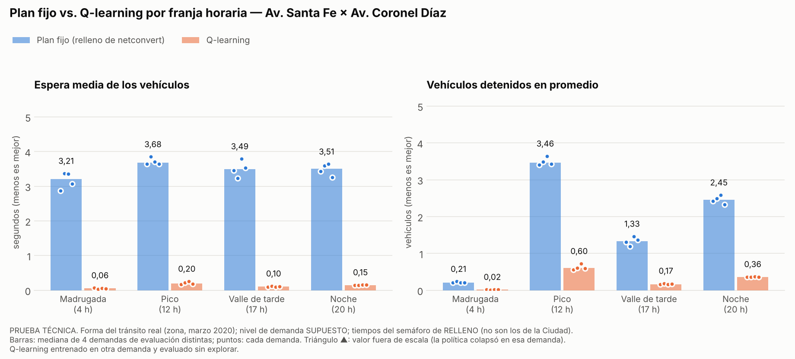

# Semaforos-CABA
Sistema de análisis y simulación para estudiar posibles mejoras en los tiempos de los semáforos y la circulación vehicular en la Ciudad de Buenos Aires.

## Cómo empezar

1. Instalar el entorno (Windows, Linux o WSL): [docs/setup-sumo.md](docs/setup-sumo.md)
2. Correr la demo: `python scripts/run_sumo_rl_demo.py --scenario santa-fe-coronel-diaz`
3. Ver el escenario: `sumo-gui -c scenarios/santa-fe-coronel-diaz/cruce.sumocfg`

## Contenido

| Ruta | Qué hay |
|---|---|
| `scenarios/` | Escenarios de SUMO (red + demanda). Ver [scenarios/README.md](scenarios/README.md) |
| `scripts/run_sumo_rl_demo.py` | Plan fijo vs. Q-learning (SUMO-RL) sobre un escenario |
| `scripts/build_scenario.py` | **Regenera un escenario desde OpenStreetMap.** Usarlo para crear o reconstruir cruces |
| `scripts/validar_demoras.py` | Velocidad simulada por calle y franja; compara con datos observados |
| `scripts/tls_template.py` | Genera la plantilla para cargar tiempos reales de un semáforo |
| `docs/setup-sumo.md` | Instalación y problemas conocidos |
| `docs/integracion.md` | Cómo se conectan los datos de las otras tareas con la simulación |

## Demo: plan fijo vs. Q-learning por franja horaria

**Cruce piloto de la demo: Av. Santa Fe × Av. Coronel Díaz** (`scenarios/santa-fe-coronel-diaz`). El corredor de 5 a 10 cruces todavía no está definido y queda para la etapa siguiente.

Con el entorno instalado ([docs/setup-sumo.md](docs/setup-sumo.md)) y `pip install matplotlib`:

```bash
python scripts/demo_franjas.py --scenario santa-fe-coronel-diaz --salida franjas
python scripts/graficar_franjas.py
```

Tarda unos 8 minutos (4 franjas). Deja los resultados en `results/franjas/` y el gráfico en `docs/franjas_fijo_vs_ql.png`. Una corrida de ejemplo está en `results_ejemplo/`. Detalle y limitaciones: [docs/prototipo-franjas.md](docs/prototipo-franjas.md).



## Estado

Es una **prueba técnica, no una conclusión sobre el semáforo real**. No se puede decir que Q-learning mejore nada en CABA.

| Etiqueta | Qué es | Qué entra |
|---|---|---|
| **REAL** | Dato de una fuente verificable | Red vial (OpenStreetMap). Forma horaria del tránsito (API de Transporte, semana típica de marzo de 2020, zona `48Q3CH00`, ~5 km) |
| **SUPUESTO** | Valor elegido por el equipo | Nivel de demanda: `--base-period` (3 s por defecto), dividido por el índice horario de cada franja |
| **RELLENO** | Valor por defecto hasta tener el dato real | Plan fijo de 90 s (41/4/41/4) generado por `netconvert`; se reemplaza con `plan-real.add.xml` |

Limitaciones a tener presentes:

- No existe un dataset abierto con tiempos de ciclo o fases de los semáforos. La columna `horario` de Cruces Semaforizados es el horario de modo titilante.
- Los conteos vehiculares son de 2020, a nivel zona y solo 6 zonas: sirven para la forma horaria, no para el volumen de un cruce.
- El GTFS estático tiene horarios programados, no observados: no alcanza para un mapa de demoras.
- **Q-learning es inestable:** en una corrida (14/11) una demanda del valle lo hizo colapsar (351 s de espera media); en la del 19/11 no. Por eso se entrena con una semilla, se evalúa en 4 distintas sin aprender y se reportan medianas.

Pendiente: medir el ciclo real del cruce, definir el corredor, respuesta del GCBA sobre planes semafóricos.
